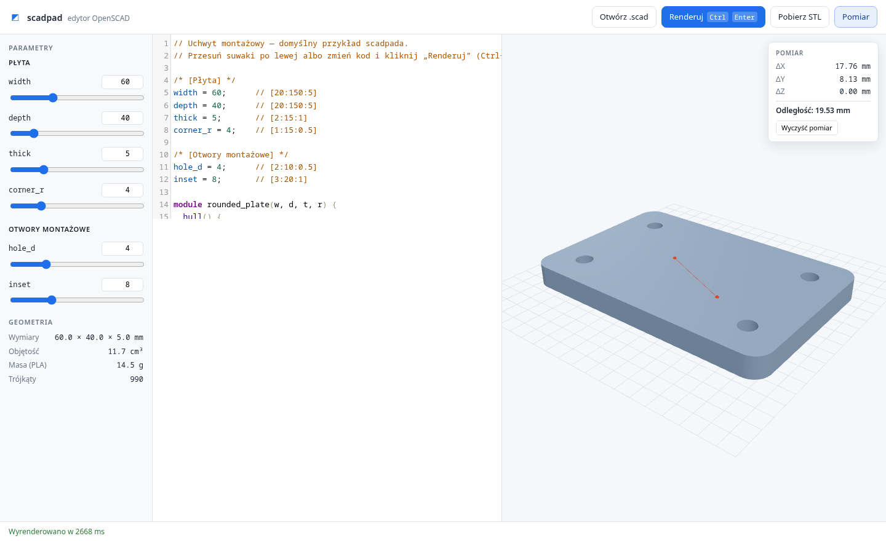

# scadpad

OpenSCAD in the browser: edit `.scad`, see the model in 3D, **measure it in millimetres**, export STL. No install, no backend, no account.

[](https://github.com/USER/scadpad/actions/workflows/ci.yml)

## Why

OpenSCAD renders fine. What it is bad at is everything you do *after* the render: you cannot click two faces and read the distance, the Customizer lives only in the desktop GUI, and a warning is a line of text with no location. scadpad keeps the language, the libraries and the `.scad` files you already have, and puts the missing tools around them.



## What it does

| | |
|---|---|
| **Editor** | CodeMirror with OpenSCAD highlighting, `Ctrl+Enter` renders |
| **Parameters** | the OpenSCAD Customizer format — sliders, number fields, checkboxes, choices |
| **3D preview** | orbit/pan/zoom, Z-up like OpenSCAD, viewpoint kept while you tweak |
| **Measure** | click two points → ΔX, ΔY, ΔZ and the distance; snaps to corners and edges |
| **Geometry stats** | bounding box, volume, PLA mass, triangle count |
| **Export** | binary STL download of the last render |
| **Diagnostics** | OpenSCAD errors and warnings, with the raw log one click away |

The parameter panel understands the same comments the desktop Customizer does:

```scad
/* [Płyta] */
width = 60;      // [20:150:5]
mode = "plain";  // [plain, chamfer, fillet]
corner = true;
```

## Quick start

```bash
npm ci
npm run dev        # http://localhost:5173
npm test           # unit tests: parsers and geometry
npm run build      # static build in dist/
```

Browser-level checks (needs a Chromium download, not needed for normal development):

```bash
npx playwright install chromium
npm run build && npm run preview &
npm run smoke
```

The build is fully static and uses a relative base, so it works from any subpath — `/edytor/`, a GitHub Pages project page, or a plain directory served locally.

## Measurements

Click **Pomiar**, then click two points on the model.

- Near a **corner or an edge**, the hit point snaps to that vertex, so you get an exact number instead of an eyeballed one.
- In the middle of a flat face, the exact surface point is used — no invented snapping to invisible triangulation vertices.
- The snap decision is geometric, not screen-space: a vertex counts as a feature when adjacent triangles meet at more than 20°.
- A third click starts a new measurement.

This is deliberately *not* a full CAD measurement tool: no face-centre snapping, no projected dimensions on a drawing, no tolerance stack-up.

## Limitations (read before you rely on it)

- **No `include`/`use` resolution.** A model that pulls in BOSL2 or MCAD fails with `Can't open include file`. Package resolution is the next project (`scadpkg`).
- **The first render is slow: ~3–5 s**, because it downloads and instantiates a ~24 MB WASM build of OpenSCAD (6 MB gzipped). After that, a render costs **40–400 ms** depending on the model, and repeating the same parameters is nearly free thanks to OpenSCAD's internal cache.
- **One renderer instance is reused.** Instantiating per render would cost about a second each time; this build survives re-entry (older OpenSCAD WASM builds abort on the second `callMain` — the package documents it), and scadpad falls back to a fresh instance whenever an abort is detected.
- **Customizer subset.** Only single-line top-level assignments with literal values become controls. Expressions, functions and modules stay as code.
- **ASCII input, binary output.** STL is written as binary; the parser accepts both.
- **No slicer integration.** Volume and mass are geometry, not a print-time estimate.

## Architecture

```
src/
  main.js           wiring, parameter panel, status and log
  editor.js         CodeMirror 5 + a small OpenSCAD mode
  params.js         Customizer comment parser (pure, tested)
  stl.js            ASCII/binary STL parser (pure, tested)
  measure.js        bbox, volume, vertex features, distances (pure, tested)
  viewport.js       three.js scene, orbit controls, picking, markers
  renderer.js       worker client: request ids, timeout, recycling
  render.worker.js  OpenSCAD WASM render, diagnostics
```

The render happens in a Web Worker and comes back as a **transferred `ArrayBuffer`**, so a multi-megabyte STL never crosses the main thread as a string.

## Embedding

The page exposes a small handle for host pages and tests:

```js
window.scadpad.setSource('cube(10);');
await window.scadpad.render();
window.scadpad.getStl();   // Uint8Array of the last good STL
```

## Deploying

Static hosting is enough:

```bash
npm run build
# copy dist/ to the web root, e.g. a Django static dir
```

Behind Django, serve `dist/` from `static/scadpad/` and point one URL at `index.html`; the bundle resolves its assets relatively.

## License

**GPL-3.0-or-later.** The OpenSCAD WASM build (`@loumalouomega/openscad-wasm`) is GPL-3.0-or-later and is bundled into the distributed build, so the combined work carries the same license. That is a consequence of using OpenSCAD's engine, not a choice of the UI code.
